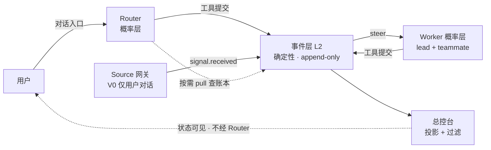
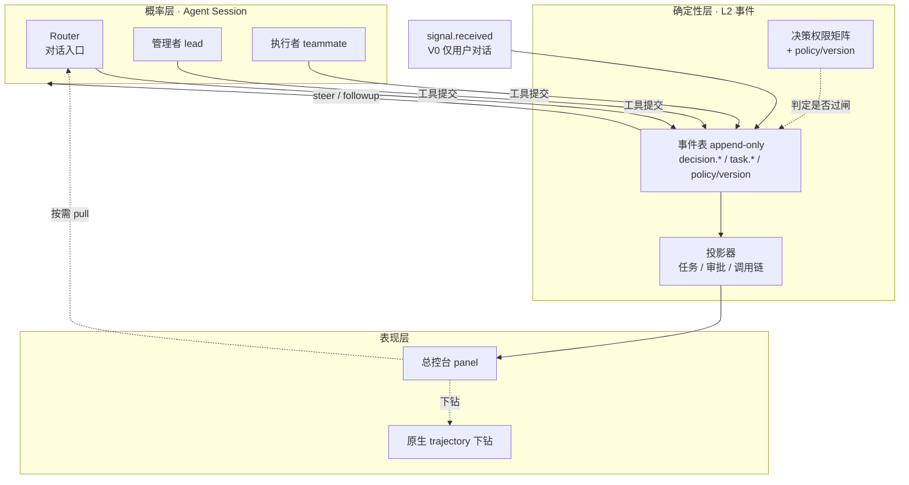
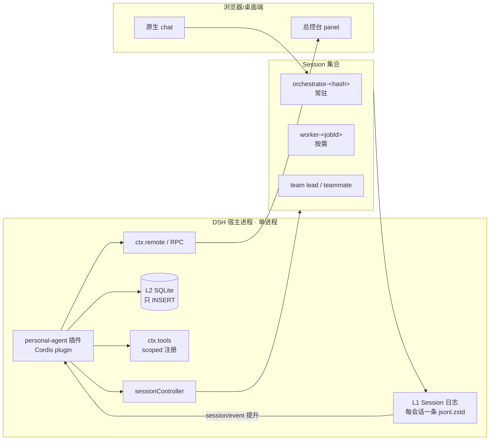
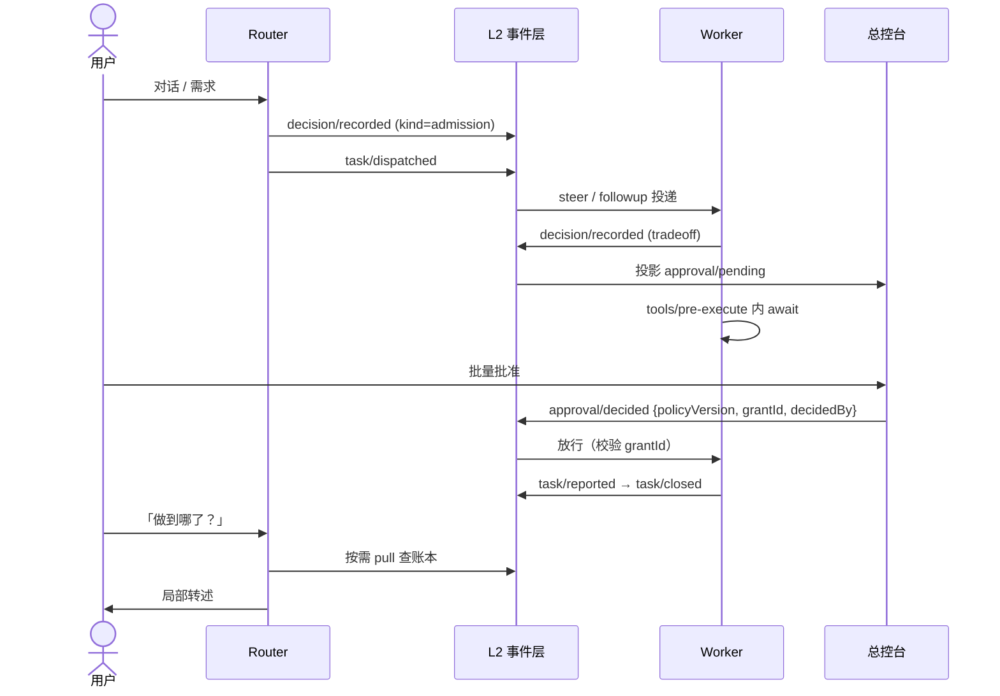
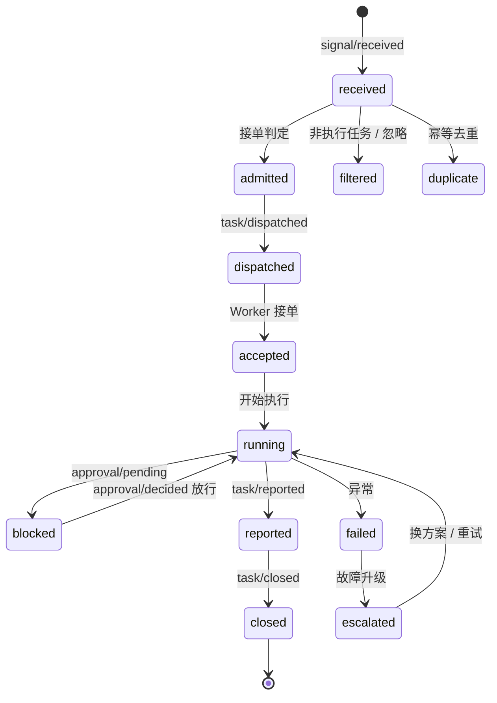

# DSH Personal Agent — V0 架构设计方案

> **版本** v0.1　|　**日期** 2026-11-14

---

## 0. 文档定位与决策状态

### 0.1 本文解决什么

把讨论结论收敛成一份**可进入开发的架构方案**

### 0.2 决策状态图例

| 标记 | 含义 | 处理方式 |
|---|---|---|
| `[F]` | 已初步定轨的决策 | 架构决策 |
| `[R]` | 建议默认 Recommended | 工程契约，开工前确认 |
| `[X]` | 明确不做 Excluded | V0 范围外，仅保留接口 |
| `[V]` | 待实测 Verify | 需 PoC 运行时验证 |

### 0.3 证据来源

- **本机用户数据**：`C:\Users\GZX\.dsh\`（`sessions/`、`storages/`、`profiles/desktop/`）
- **官方原型源码**：`D:\AiCoding-Gzx\dsh-superagent-prototype`（仅作模式借鉴，不复用代码）

---

## 1. 项目定位

### 1.1 要解决的问题 `[F]`

**降低用户的注意力消耗**、**同时处理更多的外界事件**：人只在一个窗口（router）对话，不必切换会话看执行过程、不必逐窗口点审批、不必追着问进度。

由此推出两条产品约束：

1. Router 是**对话承接方**；
2. 状态与审批**不经过 Router 转述**，人自己可见（总控台）；

### 1.2 产品形态 `[F]`

一个 **DSH 宿主插件**（Cordis plugin / bundle）：

- 复用本体的 Session、append-only 事件日志、工具、权限、trajectory UI、定时调度；
- 自建的只有 **领域事件层 + 总控台 panel + 一组领域工具**；
- 不 fork `dsh-superagent`，不引入 GitHub / 单仓库假设。

### 1.3 V0 目标与非目标

**目标**：跑通一条最小闭环（§13.2），证明「确定性事件层 + 概率两端」的形状成立。

**非目标** `[X]`：长期记忆与用户画像、外部 Source 适配器（摄像头 / GitHub / Webhook）、工具管理体系（全局池 / 局部池）、按 teammate 配置模型/工具/提示词、观测事件独立类型、多 Router / 跨进程、UI 视觉精修、性能与多实例。

### 1.4 一句话架构 `[F]`

> 把**审批、任务状态**从概率层上提到确定性层；总控台是该层的投影与过滤器；Router 只做意图理解、派发与按需转述。

---

## 2. 概念模型

### 2.1 管家 / 账本 `[F]`

| 角色 | 比喻 | 架构含义 |
|---|---|---|
| Router | 贴身管家（权限更高的秘书） | 唯一对话入口、懂偏好、不执行任务、可用便宜模型 |
| 总控台 | 管家的**账本** | 底层机制自动记、管家不记账、管家按需 pull 查询、用户随时可看 |

关键不只是「状态不经 Router」，而是 **Router ↔ L2 是 pull 不是 push**。这保住 Router 的上下文预算，也是「注意力」目标的落点。

### 2.2 三种角色与两层委派 `[F]`

```
Router（分发层 · 必须有）
 ├─ 直接派 → 执行 Worker（单 agent，规划在内部完成）
 └─ 派 → 管理者 Worker（agent-team lead，按需启动）
            └─ 派生 teammate（子代理，由 lead 聚合，不上发 Router）
```

- worker 是**独立 Session**。
- 管理者 worker 只在「单 agent 难完成」时存在；不存在时规划由 Worker 内部完成。

### 2.3 三层架构 `[F]`



两端是概率层（模型），中间是确定性层（事件）。**所有状态归属权在中间层**，两端只提交事实与消费决定。

### 2.4 术语表

| 术语 | 定义 |
|---|---|
| **L1** | DSH Session 自带的 append-only typed 事件日志，权威事实源，不碰、不双写 |
| **L2** | 本项目自建的领域事件层；订阅 L1 把关键事件**提升**成结构化一等事件 |
| **signal.received** | 统一外部信号入口（V0 唯一来源 = 用户对话），带 `sourceId` 与幂等键 |
| **approval/pending → decided** | 未来动作的门禁，按需派生、阻塞、带决定者与规则版本 |
| task.\* | 任务委派与派生状态机（无 `status` 字段） |
| `correlationId` | 域标识，串起一次任务的所有事件与 Session |
| `causationId` | 父子事件 / 父子委派的因果指针 |
| `grantId` | 审批决定产出的执行令牌，绑定「批了什么」与「做了什么」 |
| `policyVersion` | 决策权限矩阵的版本号，每条决定必须引用 |
| `splicedSeq` | `agent/inbox/spliced` 事件的 seq，即消息插入目标上下文的位置 |

---

## 3. 依据：DSH 本体能力基线

### 3.1 本体是什么

官网定位：开源、基于 Cordis 的 **"everything is a plugin"**、composable plugins、Creator mode、Automation、execution traces。

`asar:dsh-session/README.md:2,12,102`：

> "The **event-sourced** session log and in-memory store" / "records every **model-visible fact** in an **append-only** session log" / "a Session is an append-only log of typed `SessionEvent`s, and everything else derives from that stream"

本机实测单会话 9.68 MB / 22843 个 zstd frame / **32047 行 JSON 事件**，含 `tool/call 920`、`tool/result 927`、`reasoning-chunks 8369`、`step/start|end 921`、`turn/start 26`、`compaction/prune`（遮蔽而非删除）。

### 3.2 直接复用（别重造）

| 能力 | 证据 |
|---|---|
| append-only 事件日志、重放、投影 | `asar:dsh-session/README.md:12,102,163`；`dsh-session-query/README.md:35` |
| 事件流订阅（非轮询） | `sessionController.events/follow`；`dsh-api-session-controller` 订阅 `session/event` |
| `steer` / `followup` / `inject` + durable inbox + `requestId` 幂等 | `asar:dsh-agent-loop/lib/index.js:570-578,79-85` |
| 思考过程 / 工具链 / token 的 UI | `dsh-client-ui-chat` verbose + `dsh-client-ui-trajectory` |
| 上下文压缩 / token 统计 | `dsh-compaction*` 遮蔽式事件、`dsh-token-meter`、`dsh-session-stats` |
| 写 / 命令边界观测 | `dsh-fs-sandbox`、`dsh-bash-sandbox`、`dsh-workspace-changes` |
| 任务依赖 DAG / 共享任务板 | `dsh-experimental-agent-team` 的 `team_task_create` + `dependencies` + CAS |
| 团队通信与只读投影 | `team/member|task|message/*` 日志事件 + `agentTeam` 投影广播 |
| 工具动态装卸 | `ctx.tools.register` disposer、`restrict({allow,deny})`、`when`、`tools/change` |
| 插件热插拔 / UI 挂载 | `dsh-hmr`、`cordis-plugin-loader`、`dsh-client-ui-layout` 的 slot |

### 3.3 本体的硬限制（必须自建的原因）

| 限制 | 证据 |
|---|---|
| `ctx.emit` 是进程内同步内存广播，**不持久、不可重放** | `asar:cordis/src/events.ts:124-129,203-205` |
| Session 完全隔离，**无共享状态通道** | `asar:dsh-agent/README.md:74,217` |
| **子代理审批被固定 `never`** | `asar:dsh-subagent/lib/index.js:364` |
| 审批 pending 不持久、无 resume token、恢复不重新提问 | `asar:dsh-user-approval/lib/index.js:47-77,153-169`；`README.zh.md:168` |
| `PendingApproval` 不含工具参数 | `asar:dsh-client-ui-approval/lib/client.js:223-246` |
| `fs-sandbox` **reads 不受限** | `asar:dsh-fs-sandbox/README.md:52` |
| 无跨会话总控台、无 graph 视图、无独立 audit log 表 | `dsh-client-ui-layout` 仅提供 slot |
| `maxPendingMessagesPerMember: 64` 配置**全库 0 匹配**，不生效 | 本机 profile patch |

### 3.4 从 superagent 借鉴的模式（不搬代码）

1. **先存后做**：命令在事务内入队、提交后才执行副作用（`Store.atomic()` SAVEPOINT + `effect` 表）。
2. **确定性 ID + 三层幂等**：内容 hash ID、effect 同 key 合并 + `generation`、Session 侧 `messageId` 去重。
3. **派生状态机**：Ticket 无 `status` 字段，stage 由 `ended / attention / report / assignment` 现算。
4. **prompt 双层版本**：内置 defaults + 用户覆盖 + 不可变版本快照 + 内容 hash 冲突检测。
5. **注意力预算**：progress 不转发，只有具体 question 才上升给人，回复 100 词上限。

### 3.5 明确不碰 `[X]`

- 把 GitHub / 单仓库假设带进来（superagent 的 `Deployment.repository` 是启动硬前置，与其领域模型绑定）。
- 在 `ctx.emit` 上建持久事件（易失）。

---

## 4. 总体架构

### 4.1 分层视图



### 4.2 运行时拓扑



**进程模型** `[F]`：单进程 Cordis 插件，Router / Worker 均为宿主内独立 Session，不 spawn 外部 CLI、不建独立服务。V0 不支持多进程（本体 `dsh-subagent/README.md:210` 明说跨进程需 durable mailbox + lease）。

### 4.3 主链路（最小闭环）



### 4.4 组件清单

| 模块 | 职责 | 依赖 | 状态 |
|---|---|---|---|
| `plugin` | 插件入口、服务注入、生命周期 | Cordis / HMR | `[R]` 载体见 §5.1 |
| `session-manager` | Router / Worker 创建与复用 | `sessionController` | `[R]` |
| `ingress` | `signal.received`、接单判定 | Router + L2 | `[F]` |
| `event-store` | L2 append-only 存储、事务、幂等 | SQLite `[R]` | `[F]` |
| `promoter` | L1 → L2 提升 + checkpoint | `session/event` | `[F]` |
| `projector` | 任务 / 审批 / 调用链投影 | L2 | `[F]` |
| `policy` | 决策权限矩阵 + 版本 | L2 | `[F]` |
| `approval` | 待审批、门禁、answerer、孤儿重驱 | `tools/pre-execute`、L2 | `[F]` 形状 / `[R]` 接口 |
| `tools` | 领域工具注册与 scoped 隔离 | `ctx.tools` | `[F]` |
| `chain` | 调用链追踪 | L1 `readEvent` | `[F]` |
| `console-panel` | 总控台 UI | `dsh-client-ui-layout`、`ctx.remote` | `[F]` 形态 |
| `source-gateway` | 外部信号接入（V0 仅留接口） | — | `[X]` |

---

## 5. 运行时架构与生命周期

### 5.1 插件载体 `[R]`

| 项 | 建议默认 |
|---|---|
| 形态 | host-only Cordis bundle：`package.json` + ESM `index.js` + 自己的 `cordis.patch.yml` |
| 加载 | `dsh plugin --profile desktop add "link:<path>"` → 加入 `dsh.profile.bundles` → HMR 捕获配置变更热挂载 |
| 注入服务 | `sessions`、`sessionProjections`、`tools`、`remote`、`agentTeams`、`client-ui-layout`（具体 `inject` 名待 §12.3 侦察） |
| 状态目录 | `C:\Users\GZX\.dsh\state\personal-agent\` |
| 热更新边界 | `dsh-hmr` 的 `root: []` **只 watch 配置文件，不 watch 源码** → 热的是配置，不是代码 |

### 5.2 Session 模型 `[R]`

借鉴 superagent 的确定性 ID：

| Session | ID | 生命周期 | 创建者 |
|---|---|---|---|
| Router | `orchestrator-<hash>` | 常驻，跨任务复用 | 插件首次启动引导创建，id 持久化到 L2 `kv` |
| Worker（单 agent） | `worker-<jobId>` | 每 Job 一个，关闭后不删、只禁用工具 | Router 派发时创建 |
| 管理者 / teammate | 由 Team 管理 | 每 Job 一个 Team 域 | `spawn_teammate` |

**重启恢复** `[R]`：从 L2 `kv` 读 Router id → `sessionController.resume`；未决 `approval/pending` 由 §8.3.3 的孤儿重驱处理；进行中 Job 按 `correlationId` 重建投影。

### 5.3 启动与恢复顺序

```
插件 mount
 → 打开 L2 存储（校验 schema / checkpoint）
 → 读 Router id；不存在则创建并持久化
 → 注册领域工具（scoped，按 role 分派）
 → 注册 L1 订阅（从 checkpoint 续）
 → 启动 promoter / projector / approval answerer
 → 扫描孤儿 pending（有 pending 无 decided）→ 重驱
 → 注册总控台 panel
```

### 5.4 与 agent-team 的关系 `[F]`

| 事实 | 证据 |
|---|---|
| Team 建在 subagent 之上，不是互斥实现 | `asar:dsh-experimental-agent-team/lib/index.js:4,9,1035` |
| 「team 下 subagent 不生效」只是 profile patch 禁用三个全局工具，可绕过 | `asar:dsh-experimental-agent-team-profile/cordis.patch.yml:4-11`；`README.zh.md:107` |
| `team/*` 四种事件只存在于 Lead Session 的 append-only 日志 | `:160-162,537`；`README.zh.md:144` |
| 外部插件可只读订阅：`onChanged / onEventChanged` + `agentTeam` 投影广播所有浏览器 | `asar:dsh-session-projection/lib/index.js:188-212`；`README.zh.md:201` |
| **限制**：`spawn_teammate` 只有 `name/description/prompt/context`，九个固定工具全员相同，不能配模型/工具 | `asar:dsh-experimental-tool-agent-team/lib/index.js:250-289` |
| **限制**：实时 Team 事件不含消息正文 | `README.zh.md:130,132,184` |

→ V0 接受这两个限制：不按成员配能力（§1.3），通信正文改由 `tool/call` 订阅获取（§8.6）。

---

## 6. 事件模型（核心）

### 6.1 L1 / L2 分层原则 `[F]`

| | L1（不碰） | L2（本项目） |
|---|---|---|
| 来源 | DSH Session 自带 append-only 日志 | 订阅 `session/event`，**提升**关键事件 |
| 内容 | 所有 model-visible 事实（含思维链、工具调用、token） | 只有领域语义的结构化一等事件 |
| 权威性 | 权威事实源 | 派生层，可重放重建 |
| 只增不减 | 天然成立（compaction 用遮蔽不删除） | 表只 INSERT，状态靠插入新事件改变 |

**不双写**：L1 什么都记，L2 不重复记录原始事实，只做「提升 + 编排 + 投影」。总控台的「过滤」本质就是这层提升。审计可从 L2 的 `l1Ref` 反查 L1 原始事件。

### 6.2 L2 事件类型枚举（V0 = 8 类） `[F]`

| 类型 | 语义 | 生产者 |
|---|---|---|
| `signal/received` | 统一外部信号入口 | ingress |
| `decision/recorded` | 已发生决策的事实记录 | 所有 Agent |
| `approval/pending` | 待许可动作的门禁 | 矩阵判定（确定性层） |
| `approval/decided` | 审批决定 | 人 / 规则 |
| `task/dispatched` | 任务委派（L-A） | Router / lead |
| `task/reported` | 执行汇报 | Worker |
| `task/closed` | 任务关闭 | Router / 规则 |
| `policy/version` | 权限矩阵新版本 | 人（总控台） |

系统事件（崩溃 / 超时 / 压缩 / 工具装卸 / Source 增删）**V0 不设独立族** `[X]`，作为 L2 配置快照记录。

### 6.3 通用字段 schema `[R]`

```ts
interface L2Event {
  seq: number;                 // 单调递增，L2 内唯一
  eventId: string;             // 幂等键，UNIQUE
  type: string;                // §6.2 枚举
  time: number;                // epoch ms
  sessionId?: string;          // 产生该事件的 Session
  actor: 'router' | 'lead' | 'teammate' | 'human' | 'system';
  correlationId: string;       // Job 域
  causationId?: string;        // 父事件 eventId
  policyVersion?: string;      // 决定类事件必填
  l1Ref?: { sessionId: string; seq: number };  // 反查 L1
  payload: object;             // §6.4
}
```

### 6.4 各事件 payload `[R]`

| 类型 | payload |
|---|---|
| `signal/received` | `{ sourceId, externalId, kind, text, receivedAt }` |
| `decision/recorded` | `{ kind: 'admission' \| 'tradeoff' \| 'self' \| 'escalation', action, options[], chosen, reason, sideEffectLevel, declaredBy, requestedBy }` |
| `approval/pending` | `{ decisionId, action, options[], sideEffectLevel, policyHit, requestedBy, expiresAt }` |
| `approval/decided` | `{ pendingId, decisionId, decidedBy: 'auto' \| 'router' \| 'human' \| 'policy', ruleId, reason, policyVersion, grantId }` |
| `task/dispatched` | `{ jobId, parentTaskId?, assignee, role: 'lead' \| 'worker', goal, constraints }` |
| `task/reported` | `{ jobId, summary, artifacts[], status: 'done' \| 'blocked' \| 'failed' }` |
| `task/closed` | `{ jobId, outcome, reason }` |
| `policy/version` | `{ version, rules, changedBy, previousVersion }` |

`reasonKind` 字段**只留位、不预设分类** `[F]`。

### 6.5 append-only 与事务 `[F]`

1. **单条 append 一个事务**；状态改变 = 插入新事件，**永不 UPDATE 业务事件**。
2. **先存后做**（借鉴 superagent）：任何外部副作用（`steer` / `followup` / 放行工具 / 发通知）必须**在 L2 事务提交之后**执行。
3. 提交前 `fsync`；副作用携带 `eventId` 作为幂等键（对应本体 `requestId`）。
4. 唯一允许 UPDATE 的是技术元数据：`promoter_cursor`、`kv`（Router id、schema 版本）。

> 技术表与业务表分开，是「只增不减」在工程上不破功的关键。

### 6.6 幂等与确定性 ID `[R]`

- `eventId = sha256(type + correlationId + 规范化 payload 关键字段 + causationId)` 取前 32 位；数据库 `UNIQUE(eventId)`。
- 三层幂等：内容 hash ID（防重复提交）→ 同 key 合并 / `generation` 防覆盖（借鉴 superagent effect）→ Session 侧 `messageId` / `requestId` 去重。
- 副作用重放时必须可重入：`steer` 用同一 `requestId`；工具放行用同一 `grantId`。
- **无 DLQ** `[F]`：记录只增不减，失败以新事件表达（`task/reported status=failed` → `decision/recorded kind=escalation`）。

### 6.7 提升器与 checkpoint `[F]`

```
session/event 订阅 → 映射规则（§9.2）→ L2 append + cursor 更新（同一事务）→ 副作用
```

- 表 `promoter_cursor(session_id, last_seq)`；每处理一条 L1 事件后在同一事务内推进游标。
- 重启从 cursor 续；L1 是可重放日志，重复投递由 `eventId` 去重兜底。
- **checkpoint 是最容易漏的工程件** —— 没有它，插件重启会静默丢失事件，而 L1 里其实什么都还在。

### 6.8 投影与查询 `[F]`

| 投影 | 算法 | 消费者 |
|---|---|---|
| 任务阶段 | 按 `correlationId` 分组，取最后一个 `task.*` 事件派生（无 status 字段） | 总控台任务视图 |
| 待审批队列 | `approval/pending` 中尚无对应 `approval/decided` 的 | 总控台审批视图 |
| 已决流水 | 全部 `approval/decided`，可筛 `decidedBy` | 总控台审批视图 |
| 调用链 | 由 L1 `tool/call` + `agent/inbox/spliced` + step 边界生成 L2 边（§8.6） | 总控台调用链视图 |

### 6.9 存储选型与目录 `[R]`

- **SQLite**（`node:sqlite` 的 `DatabaseSync`，Node 22 内置，与 superagent 同款），WAL 模式。
- 路径：`C:\Users\GZX\.dsh\state\personal-agent\orchestrator.sqlite`
- 只 INSERT 业务表；借鉴 superagent 的**生成列 + 部分索引**让高频查询只扫活跃行。

---

## 7. 状态机

### 7.1 任务派生状态机（待定）



**状态 = 最后一条事件的投影**（借鉴 superagent `ticketStage()`）。`ticket` 结构体里没有 `status`，展示用的阶段由 `ended / attention / latestReport / assignment` 现算。

### 7.2 审批状态机（待定）


### 7.3 `correlationId` / `causationId` `[F]`

- `correlationId` 串起 **Job 域**：一次用户请求 → 派发 → 多层委派 → 汇报 → 关闭，以及其间所有 Session。
- `causationId` 串起 **因果链**：子事件指向父 `eventId`；父子委派（Router → lead → teammate）由此形成树。
- 通信图的**节点 = Agent**，**边 = 事件**（带 `from/to/causationId/eventSeq`）。

---

## 8. 核心机制

### 8.1 接单 / 信息拦截层 `[F]`

- **统一入口**：所有信号（用户对话、外部 Source、定时任务）先进 `signal/received`，带 `sourceId` + `externalId` 幂等键。
- **内外部事件二分**：内部事件 = `decision.*` / `task.*`；外部事件 = 环境触发。V0 唯一外部来源 = 用户对话 `[X]`。
- **泛化 admission**：把 superagent 的 GitHub login / @ 硬编码，换成「每个 Source 一份声明式准入规则（`allow / infer / ignore / escalate`）+ 全局接单策略」。
- **接单判定 = 什么交给 worker、什么 Router 直接处理或忽略**。
- **关键收敛**：接单判定**本身就是一条 `decision/recorded kind=admission`** → 因此 V0 只做「决策审批 + 任务委派」两类事件族，闭环已成立，不需要第三类。

### 8.2 决策显式化 `[F]`

- 决策必须**通过工具提交**，不能只写在自由文本 / 思维链里。
- **tradeoff 只是 `options.length > 1` 的一种特例**，不是审批的全部。
- **事件链**（`decidedBy: human`，V0 只有 human ）。

### 8.3 决策权限矩阵（待定，计划 V0 使用提示词控制）


### 8.4 任务委派（两层） `[F]`

| 层 | 路径 | 事件 | 实现 |
|---|---|---|---|
| L-A | Router → 管理 / 执行 Worker | `task/dispatched` | 自建工具 + 投递 |
| L-B | 管理者 lead → teammate | 提升 `team/task` | **直接用 agent-team 的 task board，不自造通信** |

- 状态机派生式、无 `status` 字段（§7.1）。
- `correlationId` 串 Job 域，`causationId` 串父子委派。
- 简单任务只有一个 Worker（规划在其内部完成）；复杂任务才有 lead + teammate，且子代理不上发 Router。

### 8.5 调用链追踪 `[F]`

目标不是「画一张通信图」，而是**因果归因**：当一条消息插入某 agent 上下文后，锁定它对该 agent 后续执行造成的偏移，用于复核「这条消息给任务带来了什么影响」。

#### 三个日志锚点

| 锚点 | 落盘内容 | 证据 |
|---|---|---|
| `tool/call` | 工具名 + **完整入参原串**，无 redaction / 截断 | `asar:dsh-tools/lib/pipeline.js:185-194`；`asar:dsh-session/lib/index.js:1531-1545` |
| `agent/inbox/spliced` | `{ target: next-turn\|next-step, start, inserted: UserMessage[] }`，含 `inserted[].id`、`source.senderSessionId`、事件 `seq` | `asar:dsh-agent-loop/lib/index.js:190-200`；`asar:dsh-action-cards/lib/typert.host.js:653` |
| `step/start\|end`、`turn/start\|end` | 带 `(turn, step)`；事件对象自带 `seq` + `time` | `agent-loop/lib/index.js:731,757-760,781-784,819-822` |

#### 边界与补法

- **订阅面是 team 工具集的 `tool/call`，不是单个 `send_message`**：`send_message` 只有 `target`(成员 name) + `message`，无 messageId / sessionId（`asar:dsh-experimental-tool-agent-team/lib/index.js:292-317`）；初始指令在 `spawn_teammate.prompt`，任务板正文在 `team_task_*`。
- **插入点靠 `spliced`**：带 `turn` 的 `agent/inbox/claimed` **只是内存 emit，不落盘**（`agent-loop/lib/index.js:103-110`）。
- `sendMessage()` 内部返回 `{ messageId }`，但 `send_message` 工具丢成 `{ sent: true }` → **自建包装工具应把 messageId 透出**，作为 L2 边的关联键 `[R]`。
- **影响窗口可切**：`readEvent(seq, before, after)` 与 `seq` filter 按区间取事件流（`asar:dsh-session-query/lib/index.js:1210-1233`），默认 `readWindowMax = 50` 需调大或分段。**本体没有「消息 → 受影响 step」的映射事件，这层推断必须自建**：窗口 = `spliced.seq` 后第一个 `step/start` 到对应 `step/end` / `turn/end`。

#### L2 边公式

```
边 = { fromSession, toSession, toolCallId, messageId, splicedSeq,
       window: [stepStartSeq, stepEndSeq], correlationId, causationId }
节点 = Agent
```

**示例链**：后端 Agent 发现接口契约写错 → 报给 Lead → Lead 调架构 Agent 改契约 → 同步 并行前端 Agent。四跳中每一跳都能反查出「这条意见被接受后，后续哪些行为由它引起」。

### 8.7 工具即能力入口 `[F]`

**原则**：所有能力入口由工具承载；工具代表某个 Agent 拥有的能力；卸载工具 = 关闭对应事件流；总控台不依赖任何领域工具（天然解耦）。

本体直接支持：`ctx.tools.register(def, { when })` 返回精确 disposer、`restrict({ allow | deny })` 按 `agent.ctx` scope、`tools/change` 实时影响未开始调用（`asar:dsh-tools/lib/index.js:411,433-455`）。**缺的只是工具管理界面 UI**（V0 不做）。

---

## 9. 数据与接口

### 9.1 L2 表结构 `[R]`

```sql
CREATE TABLE events (
  seq             INTEGER PRIMARY KEY AUTOINCREMENT,
  event_id        TEXT    NOT NULL UNIQUE,
  type            TEXT    NOT NULL,
  time            INTEGER NOT NULL,
  session_id      TEXT,
  actor           TEXT    NOT NULL,
  correlation_id  TEXT    NOT NULL,
  causation_id    TEXT,
  policy_version  TEXT,
  l1_session      TEXT,
  l1_seq          INTEGER,
  payload         TEXT    NOT NULL
);
CREATE INDEX idx_events_corr    ON events(correlation_id, seq);
CREATE INDEX idx_events_type    ON events(type, seq);
CREATE INDEX idx_events_pending ON events(type, seq) WHERE type = 'approval/pending';

CREATE TABLE kv (key TEXT PRIMARY KEY, value TEXT NOT NULL);
CREATE TABLE promoter_cursor (
  session_id TEXT PRIMARY KEY,
  last_seq   INTEGER NOT NULL
);
```

### 9.2 提升器映射表（L1 → L2） `[R]`

| L1 事件 | 条件 | L2 产物 |
|---|---|---|
| `tool/call` name=`pa_approval_submit` | 矩阵判定过闸 | `approval/pending` |
| `tool/call` name=`pa_task_delegate` | 全部 | `task/dispatched` |
| `team/task` | 全部 | `task/*` 提升（L-B 委派） |
| team 工具集 `tool/call` | 白名单 | 调用链边 |
| `agent/inbox/spliced` | 含 `agent-message` source | 调用链边插入点 |
| `step/start\|end`、`turn/start\|end` | — | 影响窗口边界 |

### 9.3 工具清单与参数概要 (V0 暂定两个)

| 工具 | 调用方 | 参数概要 | 产生事件 |
|---|---|---|---|
| `pa_approval_submit` | Worker | `{ decisionId, action, options[] }` | `approval/pending` |
| `pa_task_routing` | Router | `{ goal, session id（可选，填入则追加至指定id，留空则创建新会话 worker）, constraints }` | `task/dispatched` |

> 工具名与参数形状为建议默认；按 `agent.ctx` scope 注册，Router 与 Worker 工具集不同。

### 9.4 Host → Client 数据通道 `[R]`

| 选项 | 说明 | 倾向 |
|---|---|---|
| `ctx.remote` 自定义事件 / RPC | 与本体 answerer 机制同源，可双向 | **推荐** |
| typert RPC | 类型化更强，需确认注册 shape | 备选 |
| `sessionProjections` 广播 | 只读投影，无法承载审批写回 | 仅用于状态推送 |

- panel 挂载：`dsh-client-ui-layout` 的 `sidebar.panellist` + `main` keyed slot。
- 鉴权：本地桌面单用户，V0 省略。

### 9.5 关键 API 侦察清单

见 §12.3（开工前需把调用签名从 asar 中抠出，避免返工）。

---

## 10. UI 形态 `[F]`

> 视觉由设计图承担。本章只定设计原则。

1. **贴合 DSH 原生视觉语言**：flat、CSS 变量、同色板、同密度，不另起一套设计系统。
2. **状态可见但不经 Router**：用户自己看得到。

---

### 11 开工前 API 侦察

以下均有「能力存在」的证据，但**调用签名 / 注册 shape 未抠出**，直接开工容易返工：

1. `sessionController.create / resume` 方法签名与参数
2. 跨会话订阅 `session/event` 的方式（`events/follow` 还是 `sessionProjections` definition）
3. `ctx.tools.register` 按 `agent.ctx` scoped 注册的写法，与 `restrict({allow,deny})` 配合
4. `tools/pre-execute` waterfall 注册方式与 `exec` 对象字段
5. `ctx.remote` 自定义事件 / RPC 注册 shape（`dsh-api-remotes` / `dsh-typert-protocol`）
6. `dsh-client-ui-layout` 的 `sidebar.panellist` / `main` keyed slot 注册 shape
7. `sessionProjections.register` 的 definition 格式
8. `dsh plugin add "link:<path>"` + `dsh.profile.bundles` + HMR 实操流程

---

## 附录 A　证据索引

**DSH 本体**

| 主题 | 位置 |
|---|---|
| event-sourced append-only 日志 | `asar:dsh-session/README.md:2,12,102,163` |
| 每 batch zstd frame + fsync、无删除 API | `asar:dsh-session-persistence-jsonl/README.md:77,111,167` |
| `ctx.emit` 非持久 | `asar:cordis/src/events.ts:124-129,203-205` |
| Session 隔离 / 无共享状态 | `asar:dsh-agent/README.md:74,217` |
| `steer / followup / inject` + inbox | `asar:dsh-agent-loop/lib/index.js:570-578,79-85` |
| `tool/call` 完整入参落盘 | `asar:dsh-tools/lib/pipeline.js:185-194,196-206` |
| 工具注册 / restrict / `tools/change` | `asar:dsh-tools/lib/index.js:404-455`；`README.zh.md:71,88` |
| `tools/pre-execute` 门禁 | `asar:dsh-tools/lib/pipeline.js:386,624-631` |
| 审批 asked/decided、pending 不持久 | `asar:dsh-user-approval/lib/index.js:47-77,153-169,197-214` |
| 审批恢复限制 | `asar:dsh-user-approval/README.zh.md:164-168` |
| answerer 注册 / UI 形态 | `asar:dsh-client-ui-approval/lib/client.js:135-159,173-184,223-246,475-477` |
| plan 模式软约束 | `asar:dsh-plan-mode/README.md:32,81,186` |
| `agent/inbox/spliced` / claimed 不落盘 | `asar:dsh-agent-loop/lib/index.js:190-200,103-110` |
| step / turn 边界事件 | `asar:dsh-agent-loop/lib/index.js:731,757-760,781-784,819-822` |
| `readEvent` seq 窗口 | `asar:dsh-session-query/lib/index.js:1210-1233,1049` |
| 投影订阅 | `asar:dsh-session-projection/lib/index.js:39,79,188-212` |
| HMR 只 watch 配置 | `asar:dsh-hmr/README.md:27,43` |
| 跨进程约束 | `asar:dsh-subagent/README.md:210` |

**agent-team**

| 主题 | 位置 |
|---|---|
| 建在 subagent 之上 | `asar:dsh-experimental-agent-team/lib/index.js:4,9,1035` |
| `team/*` 仅日志、不含正文 | `:160-162,537`；`README.zh.md:130,132,144,184,201` |
| profile patch 禁用全局 subagent 工具 | `asar:dsh-experimental-agent-team-profile/cordis.patch.yml:4-11`；`README.zh.md:107` |
| `send_message` 参数 / 无 messageId | `asar:dsh-experimental-tool-agent-team/lib/index.js:292-317`；`README.zh.md:64,68` |
| `spawn_teammate` 四参数 / 九个固定工具 | `:250-289`；`README.zh.md:2,28` |
| `sendMessage()` 返回 messageId | `asar:dsh-experimental-agent-team/lib/index.js:1591-1611` |

**superagent（仅模式借鉴）**

`D:\AiCoding-Gzx\dsh-superagent-prototype\src\core\engine.ts`（先存后做）、`src\app\effects.ts`（effect 扫表）、`src\core\stage.ts:9-21`（派生状态机）、`src\app\prompts.ts:186-206`（版本与乐观锁）、`src\app\setup.ts:76-86`。